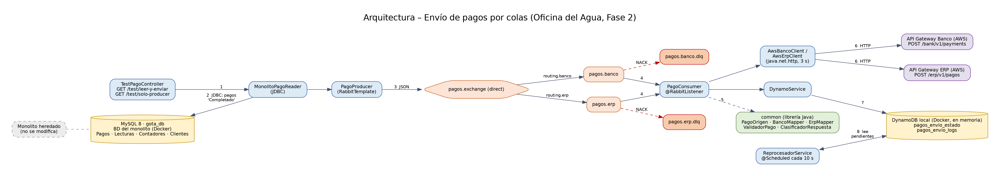
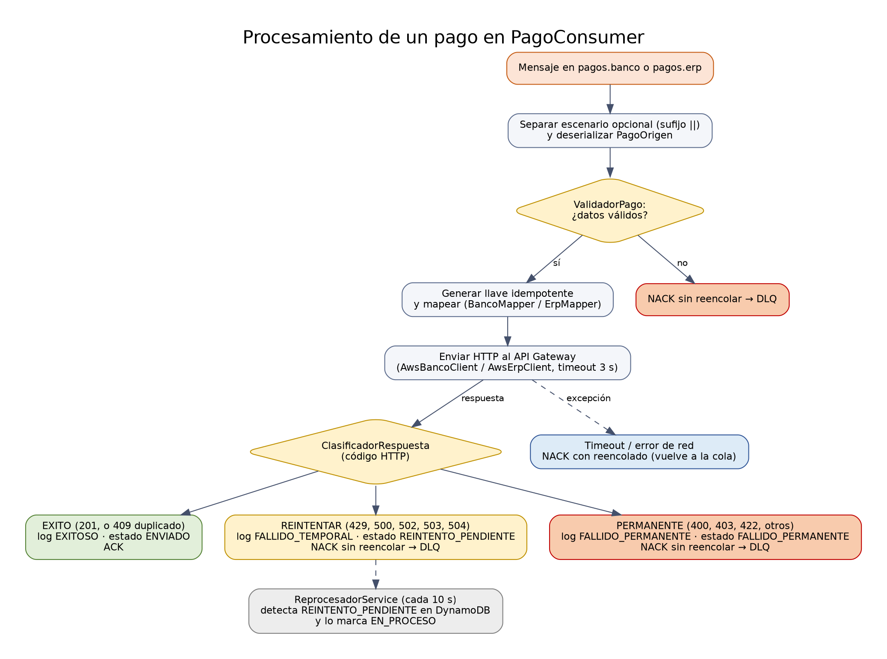

Nombre: Daniela Maricler Guitz Palma

Carnet: 0905-23-15374

Repositorio: https://github.com/DanielaGuitz/ApisPagosDW

Modulo asignado: Envío de pagos a sistemas externos por colas

---

# Oficina del Agua – Solución integrada (Fase 2)

## Tabla de contenido

1. [Contexto y objetivo](#1-contexto-y-objetivo)
2. [Arquitectura de la solución](#2-arquitectura-de-la-solución)
3. [Cómo ejecutar la solución](#3-cómo-ejecutar-la-solución)
4. [Mi módulo: envío de pagos por colas](#4-mi-módulo-envío-de-pagos-por-colas)
5. [Seguridad de la información](#5-seguridad-de-la-información)

---

## 1. Contexto y objetivo

La Oficina del Agua opera un **monolito heredado** que **no se modifica** en esta fase. Alrededor de él se construyeron cuatro funcionalidades nuevas que se integran sin alterar su código:

1. Consulta pública con captcha
2. Chatbot con RAG
3. **Envío de pagos a sistemas externos por colas** (módulo documentado en detalle en la sección 4)
4. Replicación asíncrona a NoSQL | SQL

Este repositorio contiene el módulo de envío de pagos por colas junto con la infraestructura local necesaria para ejecutarlo.

---

## 2. Arquitectura de la solución

### 2.1 Diagrama de arquitectura




### 2.2 Componentes

| Componente | Tipo | Qué hace | Ubicación |
|------------|------|----------|-----------|
| Monolito heredado | Aplicación web | Sistema central de la Oficina del Agua y origen de los pagos. No se modifica | — |
| MySQL `gota_db` | Base de datos relacional | Base del monolito (tablas `Pagos`, `Lecturas`, `Contadores`, `Clientes`, entre otras). En local corre en Docker; se crea con `db/gota_db.sql` y se llena con datos ficticios de `db/z_datos_prueba.sql` | `docker-compose.yml`, `db/` |
| RabbitMQ | Cola de mensajes | Exchange `pagos.exchange` (direct); colas `pagos.banco` y `pagos.erp`; colas de errores `pagos.banco.dlq` y `pagos.erp.dlq` | `docker-compose.yml`, `RabbitConfig.java` |
| `TestPagoController` | Controlador REST | Endpoints `GET /test/leer-y-enviar` y `GET /test/solo-producer` que disparan la lectura y la publicación de pagos | `api-bancos-spring-cloud/` |
| `MonolitoPagoReader` | Componente Spring | Lee con JDBC los pagos con estado `Completado` y los convierte a `PagoOrigen` | `api-bancos-spring-cloud/` |
| `PagoProducer` | Componente Spring | Publica cada pago en `pagos.exchange` con las rutas `routing.banco` y `routing.erp` (`RabbitTemplate`) | `api-bancos-spring-cloud/` |
| `PagoConsumer` | Componente Spring | Escucha `pagos.banco` y `pagos.erp` (`@RabbitListener`), valida, mapea, envía al sistema externo, clasifica la respuesta y confirma el mensaje | `api-bancos-spring-cloud/` |
| `AwsBancoClient` / `AwsErpClient` | Clientes HTTP | Envían la petición al API Gateway correspondiente con `java.net.http` (timeout de 3 s, cabecera `x-api-key`) | `api-bancos-spring-cloud/` |
| `DynamoService` | Componente Spring | Guarda el log de cada intento y el estado de cada envío en DynamoDB | `api-bancos-spring-cloud/` |
| `ReprocesadorService` | Tarea programada | Cada 10 segundos consulta en DynamoDB los envíos en estado `REINTENTO_PENDIENTE` | `api-bancos-spring-cloud/` |
| `common` | Librería Java | `PagoOrigen`, `BancoMapper`, `ErpMapper`, `ValidadorPago`, `ClasificadorRespuesta` e `IdempotencyKeyFactory`, compartidos por ambos destinos | `common/` |
| `api-bancos-java-feign` | Módulo Maven | Contrato OpenAPI del Banco y configuración de OpenAPI Generator (generador `java`, librería `feign`) | `api-bancos-java-feign/` |
| DynamoDB local | Base de datos NoSQL | Tablas `pagos_envio_estado` y `pagos_envio_logs`. Corre en memoria | `docker-compose.yml` |
| API Gateway Banco / ERP | Sistemas externos | Simuladores en AWS provistos por el docente, descritos por contratos OpenAPI | Externo |

### 2.3 Flujos (qué representa cada conexión)

1. **Disparo:** una petición `GET` a `/test/leer-y-enviar` o `/test/solo-producer` inicia el proceso.
2. **`MonolitoPagoReader` → MySQL `gota_db`:** consulta SQL (JDBC) de los pagos con estado `Completado`. El código del monolito no se toca; solo se lee su base de datos.
3. **`PagoProducer` → RabbitMQ:** cada pago se publica como JSON en `pagos.exchange`; la ruta `routing.banco` lo dirige a `pagos.banco` y `routing.erp` a `pagos.erp`.
4. **RabbitMQ → `PagoConsumer`:** el consumidor toma los mensajes de ambas colas con confirmación manual.
5. **`PagoConsumer` → `common`:** valida el pago, lo mapea al formato del destino y clasifica la respuesta recibida.
6. **Clientes HTTP → API Gateway Banco / ERP:** `POST /bank/v1/payments` y `POST /erp/v1/pagos`.
7. **`PagoConsumer` → DynamoDB:** registra el log del intento y el estado del envío.
8. **`ReprocesadorService` ↔ DynamoDB:** cada 10 segundos busca los envíos pendientes de reintento.

El procesamiento detallado de un mensaje se resume en el siguiente diagrama:



---

## 3. Cómo ejecutar la solución

### Requisitos

- Docker y Docker Compose
- JDK compatible con los `pom.xml` de cada módulo (cada módulo incluye `mvnw`; no hace falta instalar Maven)

### Configuración (sin secretos en el repositorio)

```bash
cp .env.example .env
```

Editar `.env` con los valores de prueba: usuario y clave locales de RabbitMQ y MySQL, y las URLs y API keys de los API Gateway entregadas por el docente. El archivo `.env` está en `.gitignore` y no se sube al repositorio.

### Levantar la infraestructura

```bash
docker compose up -d
```

| Servicio | Puertos | Notas |
|----------|---------|-------|
| RabbitMQ | 5672 (AMQP), 15672 (panel web) | Usuario y clave: los definidos en `.env` |
| DynamoDB local | 8000 | Modo `-inMemory`: los registros se pierden al apagar el contenedor |
| MySQL 8 (monolito) | 3306 | Base `gota_db`, inicializada con los scripts de `./db` |

Los scripts de `./db` solo se ejecutan cuando el contenedor de MySQL se crea desde cero. Si ya se había levantado antes, reiniciar con `docker compose down -v` y luego `docker compose up -d`.

### Compilar

No existe un `pom.xml` raíz: cada módulo se compila por separado. `common` debe instalarse primero porque `api-bancos-spring-cloud` depende de él.

```bash
cd common && ./mvnw clean install && cd ..
cd api-bancos-spring-cloud && ./mvnw clean install && cd ..
```

### Ejecutar la aplicación

```bash
cd api-bancos-spring-cloud
./mvnw spring-boot:run
```

`api-bancos-spring-cloud` contiene el lector, el productor, el consumidor y los endpoints de prueba, por lo que es la única aplicación que se ejecuta para probar el flujo. Usa el puerto 8080 por defecto; `api-bancos-java-feign` también usa 8080 por defecto, así que no deben ejecutarse al mismo tiempo.

---

## 4. Mi módulo: envío de pagos por colas

### 4.1 Funcionalidad y objetivo

El módulo toma los pagos cobrados en el monolito, los transforma al formato que exige cada sistema externo (**Banco** y **ERP**) y los envía de forma **asíncrona** mediante RabbitMQ.

**Problema de negocio que resuelve:** si el envío fuera síncrono, la lentitud o la caída de un sistema externo (el Banco puede tardar varios segundos o fallar) afectaría el proceso de cobro o dejaría pagos sin reportar. Con la cola, el pago queda en espera, el monolito no depende de la disponibilidad externa y los fallos se clasifican y registran sin perder información.

### 4.2 Integración y responsabilidades

| Componente | Responsabilidad | Por qué esta frontera |
|------------|-----------------|-----------------------|
| Monolito | Origina y almacena los pagos | **Sin modificaciones**: el módulo solo lee su base de datos (`MonolitoPagoReader`) |
| RabbitMQ | Transporte de mensajes | Aísla la disponibilidad del monolito de la de los sistemas externos |
| `common` | Validación, mapeo y clasificación de errores | Evita duplicar lógica entre Banco y ERP |
| `PagoProducer` / `PagoConsumer` | Publicar y consumir pagos | Separa la lectura del monolito del envío a sistemas externos |
| DynamoDB | Estado y bitácora de envíos | No carga ni altera la base relacional del monolito |
| API Gateway Banco / ERP | Sistemas externos | Se consumen solo por HTTP según sus contratos OpenAPI |

Las claves y URLs se leen de variables de entorno (`.env`); no están en el código ni en el repositorio.

### 4.3 Decisiones técnicas

**Decisión 1 – Contratos OpenAPI como fuente de verdad.**
Los contratos `.yaml` entregados por el docente se incluyen en `src/main/resources/openapi/` y el plugin `openapi-generator-maven-plugin` (7.12.0) está configurado en ambos módulos: generador `java` con librería `feign` para el Banco, y `spring` con `spring-cloud` para el ERP. Así las rutas, los DTOs y la autenticación (`x-api-key`) quedan alineados con el contrato real y no se escriben a mano. El envío en ejecución lo realizan `AwsBancoClient` y `AwsErpClient` con `java.net.http`, que devuelven el código de estado y el cuerpo completos; con esos datos `ClasificadorRespuesta` decide qué hacer con cada mensaje, y el cliente permite fijar explícitamente los timeouts (3 s) y las cabeceras de idempotencia y de simulación de escenarios.

**Decisión 2 – Confirmación manual y colas de errores (DLQ).**
Cada destino tiene su cola (`pagos.banco`, `pagos.erp`) y su cola de errores (`*.dlq`), enlazada por `x-dead-letter-exchange`. El consumidor usa confirmación manual (`acknowledge-mode=manual`): solo hace `ACK` cuando el envío fue exitoso. Si el pago es inválido o el destino responde con un fallo, hace `NACK` sin reencolar y el mensaje pasa a la DLQ en lugar de bloquear la cola principal; si hay timeout o error de red, hace `NACK` con reencolado para volver a intentarlo.

**Decisión 3 – `ClasificadorRespuesta`: la acción depende del tipo de fallo.**

| Resultado | Códigos HTTP | Acción |
|-----------|--------------|--------|
| Éxito | 201; 409 con `DUPLICATE_PAYMENT` / `DOCUMENTO_DUPLICADO` | Log `EXITOSO`, estado `ENVIADO`, `ACK` |
| Fallo temporal | 429, 500, 502, 503, 504 | Log `FALLIDO_TEMPORAL`, estado `REINTENTO_PENDIENTE`, `NACK` a la DLQ |
| Fallo permanente | 400, 403, 422, otros 409 y cualquier otro código | Log `FALLIDO_PERMANENTE`, estado `FALLIDO_PERMANENTE`, `NACK` a la DLQ |

Un 409 por duplicado se trata como éxito porque el destino ya tiene el pago (la llave de idempotencia evita registrarlo dos veces); un 422 nunca se arreglaría reenviándolo y un 503 sí puede recuperarse, por eso se registran con estados distintos.

**Decisión 4 – Estado y bitácora de envíos en DynamoDB.**
Cada pago se envía con una llave de idempotencia (`IdempotencyKeyFactory`) y cada intento queda registrado en `pagos_envio_logs`, mientras que `pagos_envio_estado` guarda el estado actual del envío. Esto permite trazar un pago de punta a punta y detectar los pendientes (`ReprocesadorService`) sin escribir en la base del monolito.

### 4.4 Instrucciones para probar el módulo

**Requisitos previos**

- Haber hecho la configuración y el `docker compose up -d` de la sección 3. La base `gota_db` se carga con 6 pagos ficticios: 5 en estado `Completado` y 1 `Pendiente`.
- Tener en `.env` las URLs y API keys de los API Gateway entregadas por el docente (no se incluyen en el repositorio). Sin ellas el consumidor no puede completar el envío.
- Tener en ejecución `api-bancos-spring-cloud` (`./mvnw spring-boot:run`).

**Paso 1 – Flujo completo**

Abrir en el navegador:

```
http://localhost:8080/test/leer-y-enviar
```

**Resultado esperado:** la página responde `Se enviaron 5 pagos a RabbitMQ:` seguido de una línea por pago (por ejemplo `Pago ID: 1 | Cliente: Ana López | Monto: Q45.00`). El pago `Pendiente` no se envía. En la consola de la aplicación, cada mensaje aparece como `CONSUMER BANCO recibió pago` o `CONSUMER ERP recibió pago`, seguido de `Respuesta de AWS (...): HTTP <código>` y, si fue exitoso, `Pago EXITOSO. ACK`.

**Paso 2 – Verificar RabbitMQ**

Abrir `http://localhost:15672` e iniciar sesión con el usuario y la clave de RabbitMQ definidos en `.env`. En la pestaña *Queues* se ven las colas `pagos.banco`, `pagos.erp`, `pagos.banco.dlq` y `pagos.erp.dlq`, con la actividad de mensajes publicados y entregados.

**Paso 3 – Verificar el registro en DynamoDB**

Volver a abrir `http://localhost:8080/test/leer-y-enviar`: la consola de la aplicación imprime el contenido actual de las tablas `pagos_envio_estado` y `pagos_envio_logs`. Los pagos enviados con éxito aparecen con estado `ENVIADO` y un log `EXITOSO`.

**Paso 4 – Simular un fallo con el escenario del simulador**

El endpoint acepta el parámetro opcional `escenario`, que se envía al API Gateway en la cabecera `X-Simulation-Scenario`:

```
http://localhost:8080/test/leer-y-enviar?escenario=TIMEOUT
```

**Resultado esperado:** el destino responde con un fallo o no responde en 3 s. Según el caso, el pago queda como `REINTENTO_PENDIENTE` (fallo temporal, mensaje a la DLQ) o como `FALLIDO_PERMANENTE` (mensaje a la DLQ), y la cola `pagos.*.dlq` correspondiente muestra el mensaje en el panel de RabbitMQ. Pasados unos segundos, la consola muestra `[REPROCESADOR] Encontrados ... pagos pendientes de reintento`.

**Paso 5 – Probar solo la publicación**

```
http://localhost:8080/test/solo-producer
```

Lee los pagos, publica el primero (con escenario `SUCCESS`) en `pagos.banco` y `pagos.erp`, y responde `Prueba de Productor exitosa`. En la consola se ven los pasos `[PRODUCER-TEST] 1.` a `4.`.

### 4.5 Alcance de la implementación

- `MonolitoPagoReader` lee hasta **5 pagos** por consulta con estado `Completado`.
- La base del monolito no almacena NIT: se envía `CF` (Consumidor Final). El monto de cada pago se asigna al rubro "Agua potable".
- `ReprocesadorService` identifica los envíos en `REINTENTO_PENDIENTE` y los marca como `EN_PROCESO`; no vuelve a publicarlos en la cola.
- DynamoDB local corre en memoria: los registros se reinician al apagar el contenedor.

---

## 5. Seguridad de la información

- No se publican contraseñas, API keys, tokens ni archivos `.env`.
- Las credenciales se leen de variables de entorno; el repositorio incluye `.env.example` con valores ficticios.
- El repositorio se inició sin secretos en sus archivos ni en su historial.
