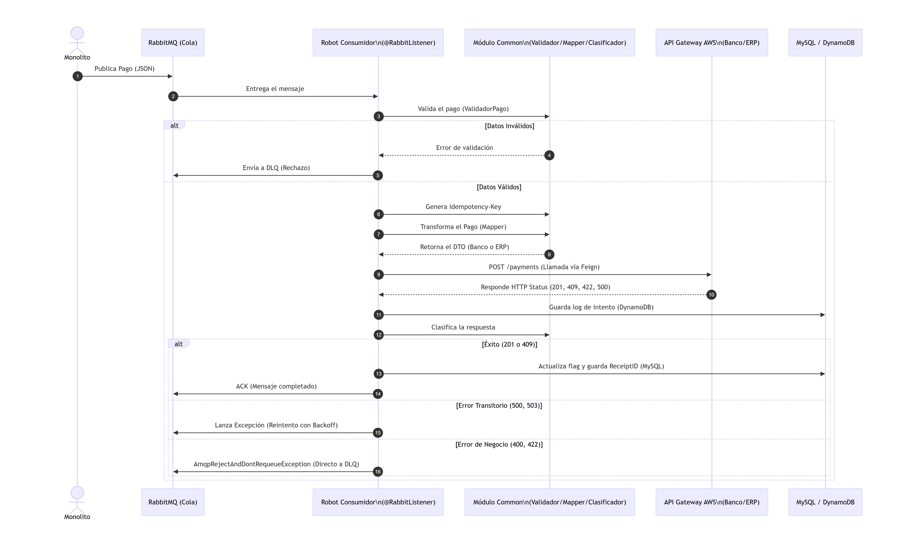
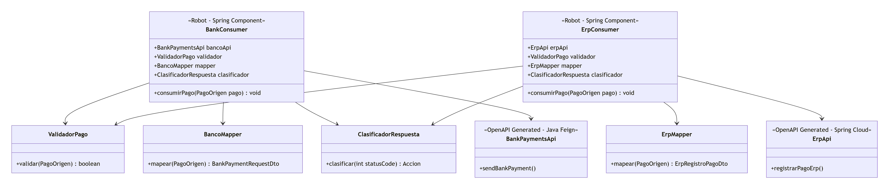

Nombre: Daniela Maricler Guitz Palma

Carnet: 0905-23-15374

Repositorio: https://github.com/DanielaGuitz/ApisPagosDW

Modulo asignado: Envío de pagos a sistemas externos por colas

---

# Oficina del Agua – Solución integrada (Fase 2)

## Tabla de contenido

1. [Contexto y objetivo](#1-contexto-y-objetivo)
2. [Arquitectura de la solución](#2-arquitectura-de-la-solución)
3. [Cómo ejecutar la solución](#3-cómo-ejecutar-la-solución)
4. [Mi módulo: envío de pagos por colas](#4-mi-módulo-envío-de-pagos-por-colas)
5. [Seguridad de la información](#5-seguridad-de-la-información)

---

## 1. Contexto y objetivo

La Oficina del Agua opera un **monolito heredado** que **no se modifica** en esta fase. Alrededor de él se construyeron cuatro funcionalidades nuevas que se integran sin alterar su código:

1. Consulta pública con captcha
2. Chatbot con RAG
3. **Envío de pagos a sistemas externos por colas** (módulo documentado en detalle en la sección 4)
4. Replicación asíncrona a NoSQL | SQL

Este repositorio contiene el módulo de envío de pagos por colas junto con la infraestructura local necesaria para ejecutarlo.

---

## 2. Arquitectura de la solución

### 2.1 Diagramas




### 2.2 Componentes

| Componente | Tipo | Qué hace | Ubicación |
|------------|------|----------|-----------|
| Monolito heredado | Aplicación web | Sistema central de la Oficina del Agua y origen de los pagos. No se modifica | — |
| MySQL `gota_db` | Base de datos relacional | Base del monolito (tablas `Pagos`, `Lecturas`, `Contadores`, `Clientes`). En local corre en Docker y se inicializa con los scripts de `db/` | `docker-compose.yml`, `db/` |
| RabbitMQ | Cola de mensajes | Exchange `pagos.exchange`; colas `pagos.banco` y `pagos.erp`; colas de errores `pagos.banco.dlq` y `pagos.erp.dlq` | `docker-compose.yml` |
| `MonolitoPagoReader` | Componente Spring | Lee con JDBC los pagos con estado `Completado` y los convierte a `PagoOrigen` | `api-bancos-spring-cloud/` |
| `PagoProducer` | Componente Spring | Publica cada pago en `pagos.exchange` (rutas `routing.banco` y `routing.erp`) usando `RabbitTemplate` | `api-bancos-spring-cloud/` |
| `PagoConsumer` | Componente Spring | Escucha `pagos.banco` y `pagos.erp` (`@RabbitListener`), envía cada pago al sistema externo correspondiente y registra el resultado | `api-bancos-spring-cloud/` |
| `ReprocesadorService` | Tarea programada | Cada 10 segundos revisa los envíos registrados en DynamoDB y reprocesa los que lo requieren | `api-bancos-spring-cloud/` |
| `TestPagoController` | Controlador REST | Endpoints de prueba que disparan la lectura y el envío de pagos | `api-bancos-spring-cloud/` |
| `common` | Librería Java | Modelo `PagoOrigen` y `RubroDetalle`, mappers (Banco y ERP), validaciones y `ClasificadorRespuesta` | `common/` |
| `api-bancos-java-feign` | Cliente Java | Cliente Feign del API del Banco, generado con OpenAPI Generator (generador `java`) | `api-bancos-java-feign/` |
| DynamoDB local | Base de datos NoSQL | Tablas `pagos_envio_estado` (estado de cada envío) y `pagos_envio_logs` (un registro por intento). Corre en memoria | `docker-compose.yml` |
| API Gateway Banco / ERP | Sistemas externos | Simuladores en AWS provistos por el docente, definidos por contratos OpenAPI | Externo |

### 2.3 Flujos (qué representa cada conexión)

1. **Disparo:** una petición `GET` a `/test/leer-y-enviar` o `/test/solo-producer` (`TestPagoController`) inicia el proceso.
2. **`MonolitoPagoReader` → MySQL `gota_db`:** consulta SQL (JDBC) de los pagos cobrados. El código del monolito no se toca; solo se lee su base de datos.
3. **`PagoProducer` → RabbitMQ (`pagos.exchange`):** cada pago se publica como mensaje JSON y el exchange lo dirige a `pagos.banco` o `pagos.erp` según la ruta.
4. **RabbitMQ → `PagoConsumer`:** el consumidor toma los mensajes de ambas colas con confirmación manual y hasta 3 reintentos.
5. **`PagoConsumer` → `common`:** usa los mappers, validaciones y el `ClasificadorRespuesta` compartidos.
6. **`PagoConsumer` → API Gateway Banco / ERP:** llamadas HTTP según los contratos OpenAPI (`POST /bank/v1/payments` y `POST /erp/v1/pagos`).
7. **`PagoConsumer` → DynamoDB:** registra el estado y el log de cada intento.
8. **`ReprocesadorService` ↔ DynamoDB:** cada 10 segundos revisa los estados registrados y reprocesa los pendientes.
9. **Colas `*.dlq`:** reciben los mensajes que no pudieron procesarse tras agotar los reintentos.

---

## 3. Cómo ejecutar la solución

### Requisitos

- Docker y Docker Compose
- JDK compatible con los `pom.xml` de cada módulo (cada módulo incluye `mvnw`; no hace falta instalar Maven)

### Configuración (sin secretos en el repositorio)

```bash
cp .env.example .env
```

Editar `.env` con los valores de prueba: usuario y clave locales de RabbitMQ y MySQL, y las URLs y API keys de los API Gateway entregadas por el docente. El archivo `.env` está en `.gitignore` y no se sube al repositorio.

### Levantar la infraestructura

```bash
docker compose up -d
```

| Servicio | Puertos | Notas |
|----------|---------|-------|
| RabbitMQ | 5672 (AMQP), 15672 (panel web) | Usuario y clave: los definidos en `.env` |
| DynamoDB local | 8000 | Modo `-inMemory`: los registros se pierden al apagar el contenedor |
| MySQL 8 (monolito) | 3306 | Base `gota_db`, inicializada con los scripts de `./db` |

### Compilar

No existe un `pom.xml` raíz: cada módulo se compila por separado. `common` debe instalarse primero porque los demás dependen de él.

```bash
cd common && ./mvnw clean install && cd ..
cd api-bancos-java-feign && ./mvnw clean install && cd ..
cd api-bancos-spring-cloud && ./mvnw clean install && cd ..
```

### Ejecutar la aplicación

```bash
cd api-bancos-spring-cloud
./mvnw spring-boot:run
```

La aplicación `api-bancos-spring-cloud` es la que contiene el productor, el consumidor y los endpoints de prueba. Usa el puerto 8080 por defecto. `api-bancos-java-feign` también usa 8080 por defecto, por lo que ambos módulos no deben ejecutarse al mismo tiempo.

---

## 4. Mi módulo: envío de pagos por colas

### 4.1 Funcionalidad y objetivo

El módulo toma los pagos cobrados en el monolito, los transforma al formato que exige cada sistema externo (**Banco** y **ERP**) y los envía de forma **asíncrona** mediante RabbitMQ.

**Problema de negocio que resuelve:** si el envío fuera síncrono, la lentitud o la caída de un sistema externo (el Banco puede tardar varios segundos o fallar) afectaría el proceso de cobro o dejaría pagos sin reportar. Con la cola, el pago queda en espera, el monolito no depende de la disponibilidad externa y los fallos transitorios se reintentan sin perder información.

### 4.2 Integración y responsabilidades

| Componente | Responsabilidad | Por qué esta frontera |
|------------|-----------------|-----------------------|
| Monolito | Origina y almacena los pagos | **Sin modificaciones**: el módulo solo lee su base de datos (`MonolitoPagoReader`) |
| RabbitMQ | Transporte de mensajes | Aísla la disponibilidad del monolito de la de los sistemas externos |
| `common` | Mappers, validación y clasificación de errores | Evita duplicar lógica entre Banco y ERP |
| `PagoProducer` / `PagoConsumer` | Publicar y consumir pagos | Separa la lectura del monolito del envío a sistemas externos |
| DynamoDB | Estado y bitácora de envíos | No carga ni altera la base relacional del monolito |
| API Gateway Banco / ERP | Sistemas externos | Se consumen solo por HTTP según sus contratos OpenAPI |

Las claves y URLs se leen de variables de entorno (`.env`); no están en el código ni en el repositorio.

### 4.3 Decisiones técnicas

**Decisión 1 – Clientes HTTP generados desde el contrato (OpenAPI Generator, contract-first).**
Los contratos `.yaml` entregados definen las rutas y los DTOs de cada sistema. Generar los clientes Feign a partir de ellos mantiene el código alineado con el contrato real y evita errores al escribir las peticiones a mano. Alternativa descartada: escribir clientes y DTOs manualmente, más lento y propenso a desalinearse si el contrato cambia. Para el Banco se usó el generador `java` (Feign puro) y para el ERP el generador `spring` (Spring Cloud OpenFeign).

**Decisión 2 – Colas de errores (DLQ), confirmación manual y reintentos.**
Cada destino tiene su cola (`pagos.banco`, `pagos.erp`) y su cola de errores (`*.dlq`). El consumidor confirma manualmente (`acknowledge-mode=manual`) y reintenta hasta 3 veces con 2 segundos de intervalo inicial. Así un mensaje no se pierde si falla: se reintenta y, si no se logra, queda en la DLQ para revisión en lugar de bloquear la cola principal.

**Decisión 3 – `ClasificadorRespuesta`: reintentar solo lo que tiene sentido.**

| Tipo | Códigos HTTP | Acción |
|------|--------------|--------|
| Reintentable (transitorio) | 429, 500, 503, 504 y timeout | Se reintenta |
| Terminal (error de datos o de negocio) | 400, 403, 422 | No se reintenta |

Reintentar un 422 nunca lo arreglaría y solo saturaría la cola; reintentar un 503 sí tiene sentido porque el servicio puede recuperarse.

**Decisión 4 – Estado y bitácora de envíos en DynamoDB.**
Cada pago se publica con una clave idempotente y cada intento queda registrado en `pagos_envio_estado` y `pagos_envio_logs`. Esto permite trazar un pago de punta a punta, evitar envíos duplicados y reprocesar los pendientes con `ReprocesadorService`, todo sin escribir en la base del monolito.

### 4.4 Instrucciones para probar el módulo

**Requisitos previos**

- Haber completado la configuración y el `docker compose up -d` de la sección 3.
- Tener en `.env` las URLs y API keys de los API Gateway entregadas por el docente (no se incluyen en el repositorio).
- Tener compilados los módulos y la aplicación `api-bancos-spring-cloud` en ejecución (`./mvnw spring-boot:run`).

**Paso 1 – Publicar los pagos en las colas**

Abrir en el navegador:

```
http://localhost:8080/test/solo-producer
```

El endpoint lee los pagos cobrados de la base del monolito (hasta 5 por lectura) y los publica en RabbitMQ.

**Paso 2 – Verificar las colas**

1. Abrir `http://localhost:15672` e iniciar sesión con el usuario y la clave de RabbitMQ definidos en `.env`.
2. En la pestaña *Queues* revisar `pagos.banco` y `pagos.erp`: se ven los mensajes publicados y su procesamiento.

**Paso 3 – Flujo completo (lectura y envío)**

Abrir:

```
http://localhost:8080/test/leer-y-enviar
```

El `PagoConsumer` toma los mensajes de las colas, los mapea con los mappers de `common` y los envía a los API Gateway del Banco y del ERP. El avance se observa en la consola de la aplicación.

**Paso 4 – Probar un mensaje manual**

En RabbitMQ: *Queues* → `pagos.erp` (o `pagos.banco`) → *Publish message*, y pegar un mensaje como este:

```json
{
  "pagoId": 123,
  "clienteCodigo": "CLI-45",
  "clienteNombre": "Cliente de prueba",
  "nit": "CF",
  "contadorCodigo": "CONT-100",
  "montoTotal": 125.50,
  "rubros": [
    {
      "rubro": "AGUA_POTABLE",
      "descripcion": "Consumo de agua",
      "monto": 125.50
    }
  ],
  "formaPago": "EFECTIVO",
  "fechaPago": "2026-10-31T12:00:00-06:00[America/Guatemala]",
  "periodoAnio": 2026,
  "periodoMes": 10,
  "concepto": "Pago desde monolito"
}
```

Para simular un escenario de fallo se agrega al final del mensaje el sufijo `||` seguido del nombre del escenario (por ejemplo `||TIMEOUT`); el consumidor lo separa del JSON antes de procesarlo.

**Paso 5 – Revisar los registros en DynamoDB local**

```bash
AWS_ACCESS_KEY_ID=local AWS_SECRET_ACCESS_KEY=local aws dynamodb scan \
  --table-name pagos_envio_logs \
  --endpoint-url http://localhost:8000 --region us-east-1
```

(Equivalente para la tabla `pagos_envio_estado`.)

**Resultado esperado**

- Los pagos aparecen como mensajes en `pagos.banco` y `pagos.erp` y luego son consumidos.
- Cada pago se mapea al formato del sistema destino y se envía al API Gateway correspondiente.
- Cada intento queda registrado en `pagos_envio_logs` y el estado del envío en `pagos_envio_estado`.
- Con un escenario de fallo transitorio (por ejemplo `TIMEOUT`), el `ClasificadorRespuesta` lo clasifica como reintentable y el mensaje se reintenta hasta 3 veces; si se agotan los reintentos, pasa a la cola `*.dlq`.

### 4.5 Alcance de la implementación

- `MonolitoPagoReader` lee hasta **5 pagos** por consulta con estado `Completado`.
- La base del monolito no almacena NIT: se envía `CF` (Consumidor Final). El monto de cada pago se asigna al rubro "Agua potable".
- DynamoDB local corre en memoria: los registros se reinician al apagar el contenedor.

---

## 5. Seguridad de la información

- No se publican contraseñas, API keys, tokens ni archivos `.env`.
- Las credenciales se leen de variables de entorno; el repositorio incluye `.env.example` con valores ficticios.
- El repositorio se inició sin historial previo y se verificó que no contiene secretos.
